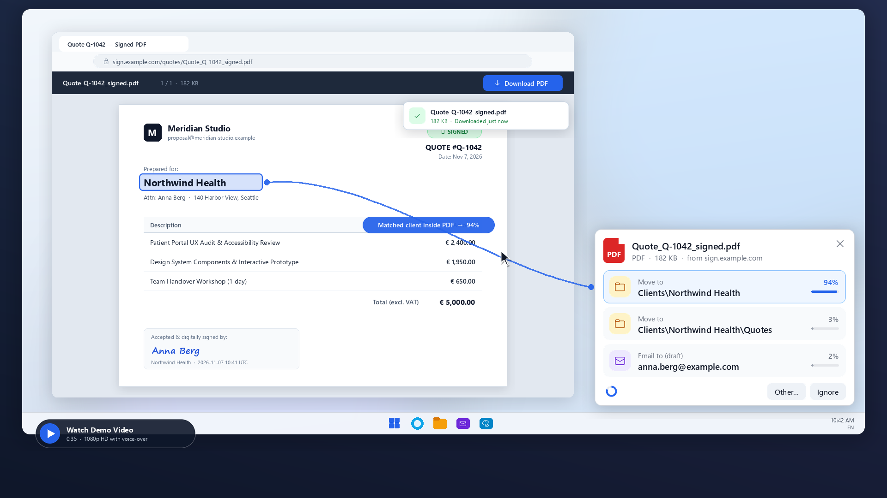

# Download Helper — Coding Agent Skill

**Download Helper** is a lightweight, 100% local desktop assistant that learns what you do with newly downloaded files — and turns multi-step filing, opening, and emailing chores into a single click.

Instead of shipping a rigid, one-size-fits-all binary, this repository packages **Download Helper as an Agent Skill** ([`skills/downloadhelper/SKILL.md`](./skills/downloadhelper/SKILL.md)). Give the skill to your coding agent (Claude Code, Codex, Gemini CLI, Cursor, T3 Code, OpenCode, etc.) and it will interview you briefly, inspect your OS, folders, apps, and mail client, build a tailored desktop app on your machine, and iteratively tune it from real usage.

[](./download_helper_demo.mp4)

> **[▶ Play the 35-second demo video (`download_helper_demo.mp4`, with voice-over)](./download_helper_demo.mp4)** · [Subtitles (`.srt`)](./download_helper_demo.srt)

---

## What Download Helper Does

Whenever a browser download finishes, a small borderless card appears in the corner of your screen with **2–4 ranked actions** tailored to that file:

1. **File to the right client or project folder (`Move to`)**  
   Reads client names inside downloaded PDFs/documents (such as signed quotes or invoices), matches them against your existing folder tree (including abbreviations and aliases), and moves the file in one click — or offers to create a new client folder when needed.
2. **Prepare an email draft with attachment (`Email to (draft)`)**  
   Recognizes files you typically forward (like expense receipts for your bookkeeper) and opens a pre-addressed draft email with the downloaded file already attached. **It never sends an email automatically** — you always review and click **Send**.
3. **Open in your preferred app (`Open with`)**  
   Learns which editor or viewer you actually use per file kind or source (for example, opening downloaded `.jpg`/`.png` images directly on the **Paint** canvas rather than a default photo viewer).
4. **Automatic mode with Undo**  
   Once a filing or opening habit is proven (3+ consecutive identical real actions with high confidence — never for email), routine downloads are handled automatically with a 15-second **Undo** card.
5. **Quiet background learning & 100% local privacy**  
   Whether you click a suggestion or move/open/attach the file yourself within ~30 minutes, Download Helper learns from your **first real action**. Everything stays strictly local on your machine: no cloud APIs, no telemetry, and no document text or full URLs stored.
6. **Configurable on the fly**  
   Right-click the card at any time to adjust the display duration (`10–120 s`, paused while hovering) or switch UI language live.

---

## Quick Start

### Option 1 — Install via `skills` CLI

```bash
npx skills add mennovergeer/downloadhelper
```

Then ask your coding agent:

> *"Use the `downloadhelper` skill to build and set up Download Helper on my machine."*

### Option 2 — Direct prompt in any coding agent

Point Claude Code, Codex, Gemini CLI, Cursor, or T3 Code directly at [`skills/downloadhelper/SKILL.md`](./skills/downloadhelper/SKILL.md):

> *"Read `skills/downloadhelper/SKILL.md` and follow it to build, install, and tune Download Helper for me."*

---

## How the Agent Builds & Tunes Your Instance

1. **Short interview (Phase 0)** — At most 6 quick questions with sensible defaults (OS/GPU, Downloads folder, 1–3 root/cloud folders, desktop mail client, existing archive for optional pre-seeding, and auto-mode preference).
2. **MVP in minutes** — Event-driven download watcher, custom anti-aliased card UI with smooth pauseable countdown ring, vote-based similarity engine (optionally blended with a tiny localhost decision model if available), and OS-native action observers.
3. **Archive pre-seeding & document matching** — Optionally scans your existing `Clients/<name>/...` archive, derives customer-name patterns, and reports leave-one-out accuracy before going live.
4. **Iterative tuning from logs** — After a handful of real downloads, ask your agent to inspect the local log; it verifies latency (`< 1–2 s`), checks hits/misses, and refines candidate rules without touching cloud services.

---

## Repository Contents

```text
downloadhelper/
├── README.md                           # Overview, demo link, and usage guide
├── download_helper_demo.mp4            # 35-second 1080p product demo with English voice-over
├── download_helper_demo.srt            # Standalone English subtitles for the demo video
├── assets/
│   └── demo-poster.png                 # Clickable 1080p preview poster for the README
└── skills/
    └── downloadhelper/
        └── SKILL.md                    # Complete coding-agent skill & build specification
```
